<p align="center">
  
</p>

# bom-sourcing

[](https://github.com/AtaCanYmc/bom-sourcing/actions/workflows/ci.yml)
[](https://github.com/AtaCanYmc/bom-sourcing/releases)
[](https://github.com/AtaCanYmc/bom-sourcing/commits/main)
[](LICENSE)
[](https://www.conventionalcommits.org)
[](#install-via-skills-cli-npx-skills)
[](#install-as-a-plugin)
[](https://github.com/AtaCanYmc/robo-market-search)

English | [Türkçe](README.tr.md)

Agent skill for extracting traceable Bills of Materials from hardware, IoT, maker, and software repositories, normalizing component names, identifying missing parts, and comparing live store pricing, stock, carts, and shipping through [robo-market-search](https://github.com/AtaCanYmc/robo-market-search).

## Table of Contents

- [Workflow Architecture](#workflow-architecture)
- [Quick Start](#quick-start)
- [Repository Layout](#repository-layout)
- [BOM Item Contract](#bom-item-contract)
- [Live Sourcing Interfaces](#live-sourcing-interfaces)
- [Verification](#verification)
- [Frequently Asked Questions](#frequently-asked-questions)
- [Governance & License](#governance--license)

## Workflow Architecture

The skill separates offline evidence extraction from optional live catalog queries. Network tools are never called during offline BOM generation.



## Quick Start

### Install via Skills CLI (`npx skills`)

Install the skill directly into supported coding agents with [skills](https://skills.sh):

```bash
# Install into the current workspace
npx skills add AtaCanYmc/bom-sourcing

# Install globally across user agent configurations
npx skills add AtaCanYmc/bom-sourcing -g
```

### Install as a Plugin

For Claude Code:

```bash
/plugin marketplace add AtaCanYmc/bom-sourcing
/plugin install bom-sourcing@bom-sourcing
```

Supported plugin manifests shipped in this repository:

| Platform | Manifest Path |
| :--- | :--- |
| Claude Code | [.claude-plugin/plugin.json](.claude-plugin/plugin.json), [.claude-plugin/marketplace.json](.claude-plugin/marketplace.json) |
| Cursor | [.cursor-plugin/plugin.json](.cursor-plugin/plugin.json) |
| Antigravity | [plugin.json](plugin.json) |
| Gemini CLI | [gemini-extension.json](gemini-extension.json) |

### Manual Symlink

Clone the repository and link the `bom-sourcing` folder into a local skills root:

```bash
git clone https://github.com/AtaCanYmc/bom-sourcing.git
cd bom-sourcing
mkdir -p ~/.agents/skills
ln -s "$(pwd)/bom-sourcing" ~/.agents/skills/bom-sourcing
```

For live pricing, stock, and cart comparison, install and verify [robo-market-search](https://github.com/AtaCanYmc/robo-market-search) before invoking live sourcing mode:

```bash
robo-search --help
```

Invoke the skill from your agent prompt against any local project directory, specifying either offline BOM extraction or live sourcing with your delivery destination and currency.

## Repository Layout

```text
.
├── .claude-plugin/
│   ├── marketplace.json
│   └── plugin.json
├── .cursor-plugin/
│   └── plugin.json
├── .editorconfig
├── .gitattributes
├── .github/
│   ├── CODEOWNERS
│   ├── ISSUE_TEMPLATE/
│   │   ├── bug_report.yml
│   │   ├── config.yaml
│   │   └── feature_request.yml
│   ├── PULL_REQUEST_TEMPLATE/
│   │   └── pull_request_template.md
│   ├── dependabot.yml
│   └── workflows/
│       ├── ci.yml
│       ├── owner-auto-merge.yml
│       └── release-please.yml
├── .gitignore
├── .markdownlint.json
├── .release-please-manifest.json
├── CONTRIBUTING.md
├── LICENSE
├── README.md
├── README.tr.md
├── ROADMAP.md
├── SECURITY.md
├── assets/
│   └── logo.png
├── bom-sourcing/
│   ├── README.md
│   ├── SKILL.md
│   └── references/
│       └── interfaces.md
├── docs/
│   ├── README.md
│   ├── bom-contract.md
│   └── live-sourcing.md
├── gemini-extension.json
├── plugin.json
├── release-please-config.json
├── schemas/
│   └── bom-output.schema.json
├── scripts/
│   └── validate_bom.py
└── tests/
    └── fixtures/
        ├── conflicting-counts.json
        ├── incompatible-variants.json
        └── offline-hardware.json
```

## BOM Item Contract

Every extracted component must populate the following fields in both offline and live outputs. See [bom-sourcing/SKILL.md](bom-sourcing/SKILL.md) for the complete specification and [schemas/bom-output.schema.json](schemas/bom-output.schema.json) for the JSON Schema.

| Field | Type | Contract |
| :--- | :--- | :--- |
| `raw_name` | String | Exact wording from the project, or a labeled description for inferred items. |
| `canonical_name` | String | Searchable standard component name that preserves hard constraints. |
| `quantity` | Integer or `null` | Positive integer or `null` when unknown. Estimates must be explained in `notes`. |
| `status` | Enum | One of `confirmed`, `inferred_required`, or `optional_or_assumed`. |
| `source_files` | Array of Strings | Project-relative `path:line` ranges, or sheet and feature identifiers for binaries. |
| `constraints` | Object | Electrical, protocol, power, dimensional, connector, and form-factor requirements. |
| `search_queries` | Array of Strings | Alternate catalog terms including part codes, module variants, and Turkish or English names. |
| `match_confidence` | Enum | One of `exact`, `partial`, `ambiguous`, or `unmatched`. |
| `stock_status` | Enum | One of `in_stock`, `low_stock`, `out_of_stock`, or `unknown`. |
| `notes` | String | Assumptions, conflicts, verification needs, compatibility warnings, and stock warnings. |

## Live Sourcing Interfaces

Live mode inspects the locally installed [robo-market-search](https://github.com/AtaCanYmc/robo-market-search) version and schema before calling any interface.

| Interface | Discovery Command or Endpoint | Primary Operations |
| :--- | :--- | :--- |
| CLI (`robo-search`) | `robo-search --help` | `robo-search search "<query>"`, `robo-search cart "<item1>" "<item2>"` |
| Python SDK (`robo_market_search`) | `from robo_market_search import Client` | `Client().search(query, limit_per_store=5)`, `Client().cart_search(queries=queries, limit_per_store=5)` |
| MCP Server (`robo-mcp`) | Inspect registered tool schemas | Supported search and cart optimization tools exposed by the active server build |
| REST API | Inspect running server `/docs` or OpenAPI schema | `GET /api/v1/search?q=...`, `POST /api/v1/cart/optimize` |

## Verification

Validate the BOM JSON schema and test fixtures locally:

```bash
python3 scripts/validate_bom.py tests/fixtures/*.json
```

Validate governance files, `SKILL.md` frontmatter, and internal markdown links locally with Python 3:

```bash
python3 -c '
import glob, os, re, sys

required = ["README.md", "README.tr.md", "LICENSE", "CONTRIBUTING.md", "SECURITY.md", "ROADMAP.md", "assets/logo.png", "bom-sourcing/SKILL.md"]
missing = [f for f in required if not os.path.isfile(f)]
if missing:
    print("Missing files:", missing, file=sys.stderr)
    sys.exit(1)

broken = []
for f in glob.glob("**/*.md", recursive=True):
    content = re.sub(r"```[\s\S]*?```", "", open(f, encoding="utf-8").read())
    content = re.sub(r"`[^`]*`", "", content)
    for link in re.findall(r"\[.*?\]\((?!https?://|mailto:)(.*?)(?:#.*)?\)", content):
        link = link.strip().split("?")[0]
        if not link or link.startswith("#"):
            continue
        target = os.path.normpath(os.path.join(os.path.dirname(f), link))
        if not os.path.exists(target):
            broken.append(f"{f} -> {link}")
if broken:
    print("Broken links:", broken, file=sys.stderr)
    sys.exit(1)

print("Governance files and internal links verified.")
'
```

## Frequently Asked Questions

#### Does live sourcing upload project source files or credentials?
No. The skill enforces a strict boundary: only sanitized component search terms are submitted to catalog services. Project files, secrets, credentials, and unrelated code remain local.

#### Why does the skill require independent verification of catalog optimizer results?
Automated catalog search matches and heuristic split-cart optimizers can select electrically incompatible variants, use stale shipping defaults, or misrepresent repeated item quantities. The skill treats optimizer output as evidence to verify against hard electrical and mechanical constraints before recommending a purchase plan.

#### Can this skill be used inside private or commercial repositories?
Yes. This repository is released under the MIT License, which permits private, internal, and commercial use with attribution.

## Governance & License

- Skill specification: [bom-sourcing/SKILL.md](bom-sourcing/SKILL.md) and [bom-sourcing/README.md](bom-sourcing/README.md)
- Reference documentation: [docs/README.md](docs/README.md), [docs/bom-contract.md](docs/bom-contract.md), and [docs/live-sourcing.md](docs/live-sourcing.md)
- Contributing guidelines: [CONTRIBUTING.md](CONTRIBUTING.md)
- Security policy: [SECURITY.md](SECURITY.md)
- Roadmap: [ROADMAP.md](ROADMAP.md)
- License: [MIT](LICENSE)
