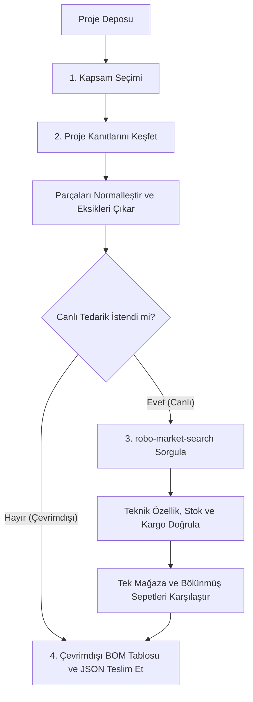

[← Read Original in English](README.md)

<p align="center">
  
</p>

# bom-sourcing

[](https://github.com/AtaCanYmc/bom-sourcing/actions/workflows/ci.yml)
[](https://github.com/AtaCanYmc/bom-sourcing/releases)
[](https://github.com/AtaCanYmc/bom-sourcing/commits/main)
[](LICENSE)
[](https://www.conventionalcommits.org)
[](#skills-cli-npx-skills-ile-kurulum)
[](#eklenti-plugin-olarak-kurulum)
[](https://github.com/AtaCanYmc/robo-market-search)

[English](README.md) | Türkçe

Donanım, IoT, maker ve yazılım depolarından izlenebilir Malzeme Listesi (BOM) çıkaran, bileşen adlarını normalleştiren, eksik parçaları tespit eden ve [robo-market-search](https://github.com/AtaCanYmc/robo-market-search) üzerinden canlı fiyat, stok, sepet ve kargo karşılaştırması yapan ajan yeteneği.

## İçindekiler

- [İş Akışı Mimarisi](#iş-akışı-mimarisi)
- [Hızlı Başlangıç](#hızlı-başlangıç)
- [Depo Yapısı](#depo-yapısı)
- [BOM Öğe Sözleşmesi](#bom-öğe-sözleşmesi)
- [Canlı Tedarik Arayüzleri](#canlı-tedarik-arayüzleri)
- [Doğrulama](#doğrulama)
- [Sıkça Sorulan Sorular](#sıkça-sorulan-sorular)
- [Yönetişim ve Lisans](#yönetişim-ve-lisans)

## İş Akışı Mimarisi

Yetenek, çevrimdışı kanıt çıkarımı ile isteğe bağlı canlı katalog sorgularını birbirinden ayırır. Çevrimdışı BOM üretimi sırasında ağ araçları çağrılmaz.



## Hızlı Başlangıç

### Skills CLI (`npx skills`) ile Kurulum

Yeteneği [skills](https://skills.sh) aracıyla desteklenen kodlama ajanlarına doğrudan kurun:

```bash
# Install into the current workspace
npx skills add AtaCanYmc/bom-sourcing

# Install globally across user agent configurations
npx skills add AtaCanYmc/bom-sourcing -g
```

### Eklenti (Plugin) Olarak Kurulum

Claude Code için:

```bash
/plugin marketplace add AtaCanYmc/bom-sourcing
/plugin install bom-sourcing@bom-sourcing
```

Bu depoda yer alan desteklenen eklenti manifestleri:

| Platform | Manifest Yolu |
| :--- | :--- |
| Claude Code | [.claude-plugin/plugin.json](.claude-plugin/plugin.json), [.claude-plugin/marketplace.json](.claude-plugin/marketplace.json) |
| Cursor | [.cursor-plugin/plugin.json](.cursor-plugin/plugin.json) |
| Antigravity | [plugin.json](plugin.json) |
| Gemini CLI | [gemini-extension.json](gemini-extension.json) |

### Manuel Sembolik Bağ

Depoyu klonlayın ve `bom-sourcing` klasörünü yerel yetenek kök dizinine bağlayın:

```bash
git clone https://github.com/AtaCanYmc/bom-sourcing.git
cd bom-sourcing
mkdir -p ~/.agents/skills
ln -s "$(pwd)/bom-sourcing" ~/.agents/skills/bom-sourcing
```

Canlı fiyat, stok ve sepet karşılaştırması için canlı tedarik modunu çalıştırmadan önce [robo-market-search](https://github.com/AtaCanYmc/robo-market-search) aracını kurup doğrulayın:

```bash
robo-search --help
```

Herhangi bir yerel proje dizini üzerinde çevrimdışı BOM çıkarımı veya teslimat hedefi ile para birimini belirterek canlı tedarik istemiyle yeteneği çağırın.

## Depo Yapısı

```text
.
├── .claude-plugin/
│   ├── marketplace.json
│   └── plugin.json
├── .cursor-plugin/
│   └── plugin.json
├── .editorconfig
├── .gitattributes
├── .github/
│   ├── CODEOWNERS
│   ├── ISSUE_TEMPLATE/
│   │   ├── bug_report.yml
│   │   ├── config.yaml
│   │   └── feature_request.yml
│   ├── PULL_REQUEST_TEMPLATE/
│   │   └── pull_request_template.md
│   ├── dependabot.yml
│   └── workflows/
│       ├── ci.yml
│       ├── owner-auto-merge.yml
│       └── release-please.yml
├── .gitignore
├── .markdownlint.json
├── .release-please-manifest.json
├── CONTRIBUTING.md
├── LICENSE
├── README.md
├── README.tr.md
├── ROADMAP.md
├── SECURITY.md
├── assets/
│   └── logo.png
├── bom-sourcing/
│   ├── README.md
│   ├── SKILL.md
│   └── references/
│       └── interfaces.md
├── docs/
│   ├── README.md
│   ├── bom-contract.md
│   └── live-sourcing.md
├── gemini-extension.json
├── plugin.json
└── release-please-config.json
```

## BOM Öğe Sözleşmesi

Çıkarılan her bileşen hem çevrimdışı hem de canlı çıktılarda aşağıdaki alanları doldurmalıdır. Tam spesifikasyon için [bom-sourcing/SKILL.md](bom-sourcing/SKILL.md) dosyasına bakın.

| Alan | Tür | Sözleşme |
| :--- | :--- | :--- |
| `raw_name` | String | Projede geçen tam ifade veya çıkarımla eklenen öğeler için etiketli eksik işlev tanımı. |
| `canonical_name` | String | Zorunlu teknik kısıtları koruyan aranabilir standart bileşen adı. |
| `quantity` | Integer veya `null` | Biliniyorsa pozitif tam sayı, bilinmiyorsa `null`. Tahminler `notes` alanında açıklanmalıdır. |
| `status` | Enum | `confirmed`, `inferred_required` veya `optional_or_assumed` değerlerinden biri. |
| `source_files` | String Dizisi | Proje göreceli `path:line` aralıkları veya ikili dosyalar için sayfa ve özellik tanımlayıcıları. |
| `constraints` | Object | Elektriksel, protokol, güç, boyutsal, konnektör ve form faktörü gereksinimleri. |
| `search_queries` | String Dizisi | Parça kodları, modül varyantları ve Türkçe veya İngilizce adları içeren alternatif arama terimleri. |
| `match_confidence` | Enum | `exact`, `partial`, `ambiguous` veya `unmatched` değerlerinden biri. |
| `stock_status` | Enum | `in_stock`, `low_stock`, `out_of_stock` veya `unknown` değerlerinden biri. |
| `notes` | String | Varsayımlar, çelişkiler, doğrulama ihtiyaçları, uyumluluk ve stok uyarıları. |

## Canlı Tedarik Arayüzleri

Canlı mod, herhangi bir arayüzü çağırmadan önce yerel kurulu [robo-market-search](https://github.com/AtaCanYmc/robo-market-search) sürümünü ve şemasını denetler.

| Arayüz | Keşif Komutu veya Uç Noktası | Temel İşlemler |
| :--- | :--- | :--- |
| CLI (`robo-search`) | `robo-search --help` | `robo-search search "<query>"`, `robo-search cart "<item1>" "<item2>"` |
| Python SDK (`robo_market_search`) | `from robo_market_search import Client` | `Client().search(query, limit_per_store=5)`, `Client().cart_search(queries=queries, limit_per_store=5)` |
| MCP Sunucusu (`robo-mcp`) | Kayıtlı araç şemalarını denetle | Aktif sunucu derlemesinin sunduğu arama ve sepet optimizasyon araçları |
| REST API | Çalışan sunucunun `/docs` veya OpenAPI şemasını denetle | `GET /api/v1/search?q=...`, `POST /api/v1/cart/optimize` |

## Doğrulama

Yönetişim dosyalarını, `SKILL.md` üst verisini ve iç Markdown bağlantılarını Python 3 ile yerel olarak doğrulayın:

```bash
python3 -c '
import glob, os, re, sys

required = ["README.md", "README.tr.md", "LICENSE", "CONTRIBUTING.md", "SECURITY.md", "ROADMAP.md", "assets/logo.png", "bom-sourcing/SKILL.md"]
missing = [f for f in required if not os.path.isfile(f)]
if missing:
    print("Missing files:", missing, file=sys.stderr)
    sys.exit(1)

broken = []
for f in glob.glob("**/*.md", recursive=True):
    content = re.sub(r"```[\s\S]*?```", "", open(f, encoding="utf-8").read())
    content = re.sub(r"`[^`]*`", "", content)
    for link in re.findall(r"\[.*?\]\((?!https?://|mailto:)(.*?)(?:#.*)?\)", content):
        link = link.strip().split("?")[0]
        if not link or link.startswith("#"):
            continue
        target = os.path.normpath(os.path.join(os.path.dirname(f), link))
        if not os.path.exists(target):
            broken.append(f"{f} -> {link}")
if broken:
    print("Broken links:", broken, file=sys.stderr)
    sys.exit(1)

print("Governance files and internal links verified.")
'
```

## Sıkça Sorulan Sorular

#### Canlı tedarik proje kaynak dosyalarını veya kimlik bilgilerini yükler mi?
Hayır. Yetenek katı bir sınır uygular: katalog servislerine yalnızca temizlenmiş bileşen arama terimleri gönderilir. Proje dosyaları, gizli anahtarlar, kimlik bilgileri ve ilgisiz kodlar yerel ortamda kalır.

#### Katalog optimizasyon sonuçları neden bağımsız doğrulama gerektirir?
Otomatik katalog eşleşmeleri ve sezgisel bölünmüş sepet optimizasyonları elektriksel olarak uyumsuz varyantlar seçebilir, güncel olmayan kargo varsayımları kullanabilir veya tekrar eden adetleri hatalı işleyebilir. Yetenek, satın alma planı önermeden önce optimizasyon çıktısını zorunlu elektriksel ve mekanik kısıtlara göre doğrulanması gereken kanıt olarak ele alır.

#### Bu yetenek kapalı veya ticari depolarda kullanılabilir mi?
Evet. Depo, atıf koşuluyla özel, kurum içi ve ticari kullanıma izin veren MIT Lisansı altında yayımlanmaktadır.

## Yönetişim ve Lisans

- Yetenek spesifikasyonu: [bom-sourcing/SKILL.md](bom-sourcing/SKILL.md) ve [bom-sourcing/README.md](bom-sourcing/README.md)
- Referans dokümantasyon: [docs/README.md](docs/README.md), [docs/bom-contract.md](docs/bom-contract.md) ve [docs/live-sourcing.md](docs/live-sourcing.md)
- Katkı rehberi: [CONTRIBUTING.md](CONTRIBUTING.md)
- Güvenlik politikası: [SECURITY.md](SECURITY.md)
- Yol haritası: [ROADMAP.md](ROADMAP.md)
- Lisans: [MIT](LICENSE)
